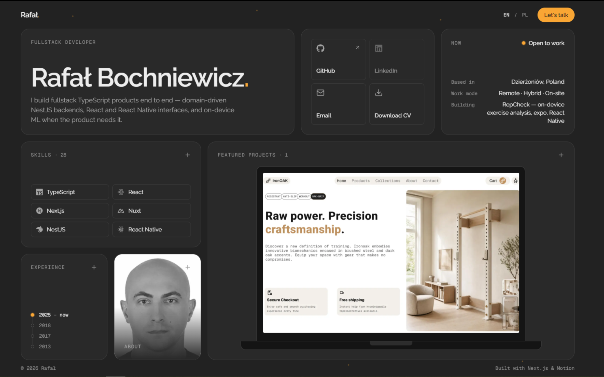

# rafalb.site

Personal portfolio of Rafał Bochniewicz, fullstack TypeScript developer. Live at [bochniewicz.dev](https://bochniewicz.dev).



## Stack

- Next.js 16 (App Router, Cache Components)
- React 19
- TypeScript
- Tailwind CSS v4
- Motion
- Radix
- Resend
- Zod 4

Hosted on Vercel.

## Key decisions

- **Two-layer design tokens.** Primitive tokens feed semantic tokens, which are exposed to Tailwind through `@theme`. The default Tailwind palette is disabled, so only project tokens can be used.
- **Bento grid with `grid-template-areas`.** The layout lives in a single CSS class. Tiles are registered in a typed section registry, and whether a tile can expand is derived from its content.
- **Expanding tiles.** Tiles open with a Motion shared layout animation. The open section is synced with the URL (`?section=`) through the native History API, so expanded views can be linked and survive a reload.
- **Typed i18n without a library.** Content is served from `/en` and `/pl` routes. The English dictionary defines the shape, so a missing translation is a compile error.
- **Data separated from text.** Language-neutral data (links, stack, dates, images) lives apart from translatable copy, so each fact is defined once.
- **Contact form as a Server Action.** Input is validated with Zod and returned as error codes that the client translates. A honeypot field filters spam, and submitted values are preserved across the React 19 form reset.
- **Fully static pages.** Both locales are prerendered, and per-locale Open Graph images are generated with `next/og`.
- **Accessibility.** Focus moves into expanded panels and back to the tile on close, the background is made inert, and animations respect `prefers-reduced-motion`.

## Getting started

```bash
pnpm install
cp .env.example .env.local
pnpm dev
```

Then open [http://localhost:3000](http://localhost:3000).

Environment variables in `.env.local`:

| Variable | Description |
| --- | --- |
| `RESEND_API_KEY` | Resend API key used by the contact form to send email. |
| `CONTACT_TO_EMAIL` | Address that receives messages from the contact form. |
| `CONTACT_FROM_EMAIL` | Sender address for those messages. It must belong to a domain verified in Resend. |
| `NEXT_PUBLIC_SITE_URL` | Canonical site origin, e.g. `https://bochniewicz.dev`. Used for canonical URLs, the sitemap, robots.txt and Open Graph images. It is inlined at build time and defaults to `http://localhost:3000`. |

## Project structure

```text
src/
├── app/            Routes, layouts, metadata, sitemap, robots, icons and OG images
├── assets/         Statically imported images and fonts
├── components/     UI components, grouped by feature (bento, tiles, contact, layout, ui, ...)
├── content/        Site content: language-neutral data plus en/pl dictionaries in i18n/
├── lib/            Shared logic: i18n config, contact form action and schema, utilities
├── providers/      Client-side context providers (Motion config)
└── proxy.ts        Redirects / to the preferred locale and remembers the choice in a cookie
```
